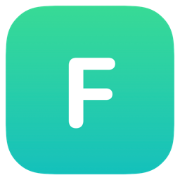

<div align="center">
  
  <h1>Flick</h1>
  <p><b>Select text anywhere, translate in one click.</b></p>
  <p>English · <a href="README.zh-CN.md">中文</a></p>
  <a href="LICENSE"></a>
  <a href="https://www.apple.com/macos/"></a>
  <a href="https://github.com/cheriL/flick/releases"></a>
</div>

## Requirements

- macOS 26+
- Accessibility permission (System Settings → Privacy & Security → Accessibility)
- Chrome (optional): enable View → Developer → Allow JavaScript from Apple Events, then accept the prompt on first use

## Installation

If macOS reports Flick as damaged on first launch (the app is unsigned), run:

```bash
/usr/bin/xattr -cr /Applications/Flick.app
```

## License

[GPL-3.0](LICENSE)
