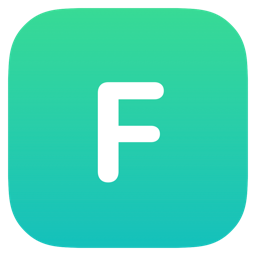

<div align="center">
  
  <h1>Flick</h1>
  <p><b>随处选词，一键翻译。</b></p>
  <p><a href="README.md">English</a> · 中文</p>
  <a href="LICENSE"></a>
  <a href="https://www.apple.com/macos/"></a>
  <a href="https://github.com/cheriL/flick/releases"></a>
</div>

## 环境要求

- macOS 26+
- 辅助功能权限（系统设置 → 隐私与安全 → 辅助功能）
- Chrome（可选）：开启 显示 → 开发者 → 允许 Apple 事件中的 JavaScript，首次取词时同意授权弹窗

## 安装

首次打开若提示「已损坏」（应用未签名），执行：

```bash
/usr/bin/xattr -cr /Applications/Flick.app
```

## 协议

[GPL-3.0](LICENSE)
